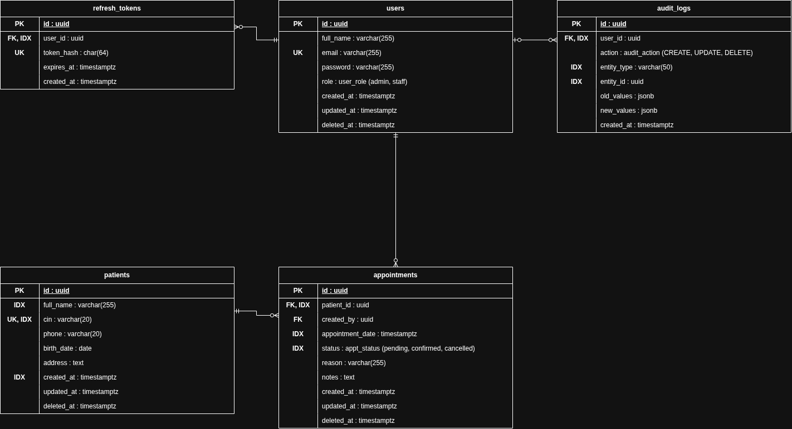

# Conception de la base de données

Le diagramme ERD est dans [erd.drawio](erd.drawio) (à ouvrir avec [app.diagrams.net](https://app.diagrams.net)).

## Relations

| Relation | Type | Justification | ON DELETE |
|---|---|---|---|
| `patients` → `appointments` | 1-N | Un patient peut avoir plusieurs rendez-vous, un rendez-vous concerne un seul patient. | `RESTRICT` |
| `users` → `appointments` (`created_by`) | 1-N | Un utilisateur crée plusieurs rendez-vous, chaque rendez-vous garde son créateur. | `RESTRICT` |
| `users` → `refresh_tokens` | 1-N | Un utilisateur peut être connecté sur plusieurs appareils (un token par session). | `CASCADE` |
| `users` → `audit_logs` | 1-N | Un utilisateur effectue plusieurs actions, chaque log garde son auteur. | `SET NULL` |

Il n'y a pas de relation N-N : un rendez-vous relie un seul patient à un seul créateur, sans table de liaison.

## Choix de conception

- **Soft delete** (`deleted_at`) sur `users`, `patients` et `appointments` : les données médicales ne sont jamais supprimées. Supprimer un patient remplit `deleted_at` sur le patient et ses rendez-vous dans une transaction. C'est pour cela que les FK des rendez-vous sont en `RESTRICT` : un `DELETE` réel est bloqué. On ne peut pas créer de rendez-vous pour un patient supprimé.
- **Utilisateur supprimé** : il ne peut plus se connecter et ses refresh tokens sont supprimés au moment du soft delete.
- **`refresh_tokens` en `CASCADE`** : un token n'a aucun sens sans son utilisateur.
- **`audit_logs` en `SET NULL`** : l'historique est conservé même si l'utilisateur disparaît. `entity_type` + `entity_id` pointent vers n'importe quelle table, donc sans FK.
- **UUID** comme clé primaire sur toutes les tables.
- **ENUM Postgres** pour `role`, `status` et `action`.
- **Règle métier** : une contrainte `EXCLUDE` empêche deux rendez-vous `confirmed` du même patient dans une fenêtre de 30 minutes. Deux rendez-vous espacés d'exactement 30 minutes (10:00 et 10:30) sont autorisés.
- **Champs obligatoires** : seuls `address` (patient) et `notes` (rendez-vous) sont optionnels, comme dans le cahier des charges.
- **Unicité** : `cin` et `email` sont uniques parmi les lignes non supprimées. Ils sont normalisés avant l'insertion (`cin` en majuscules, `email` en minuscules) pour éviter les doublons de casse.
- **Index** :
  - recherche : `patients.full_name` et `patients.cin` (GIN trigram pour `ILIKE`)
  - pagination : `patients (created_at, id)`, trié par `created_at DESC, id` pour un ordre stable
  - filtres et dashboard : `appointments (appointment_date, status)` sur les lignes non supprimées
  - rendez-vous d'un patient : `appointments (patient_id, appointment_date)`
